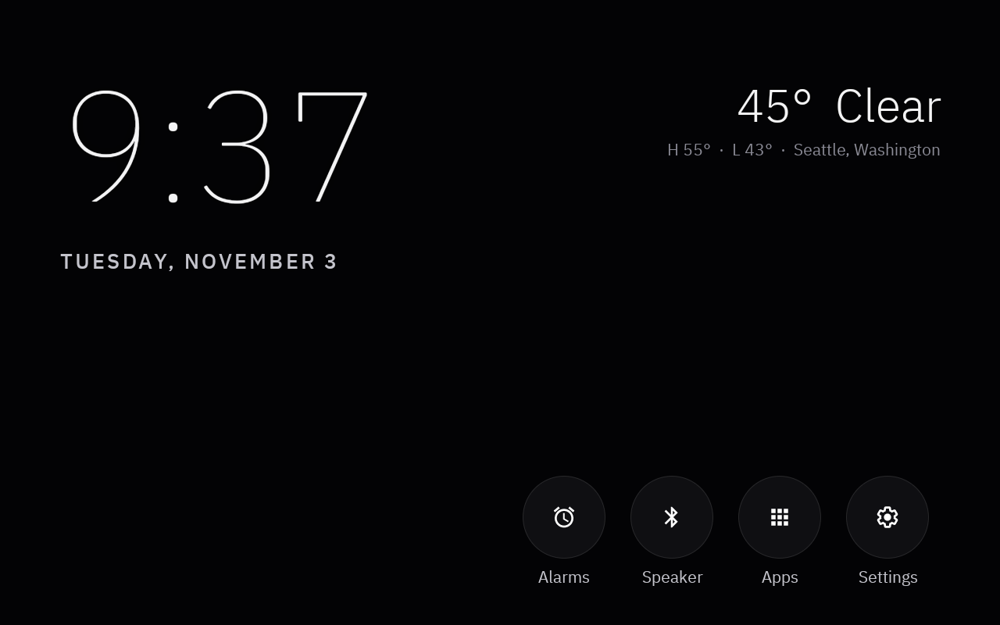
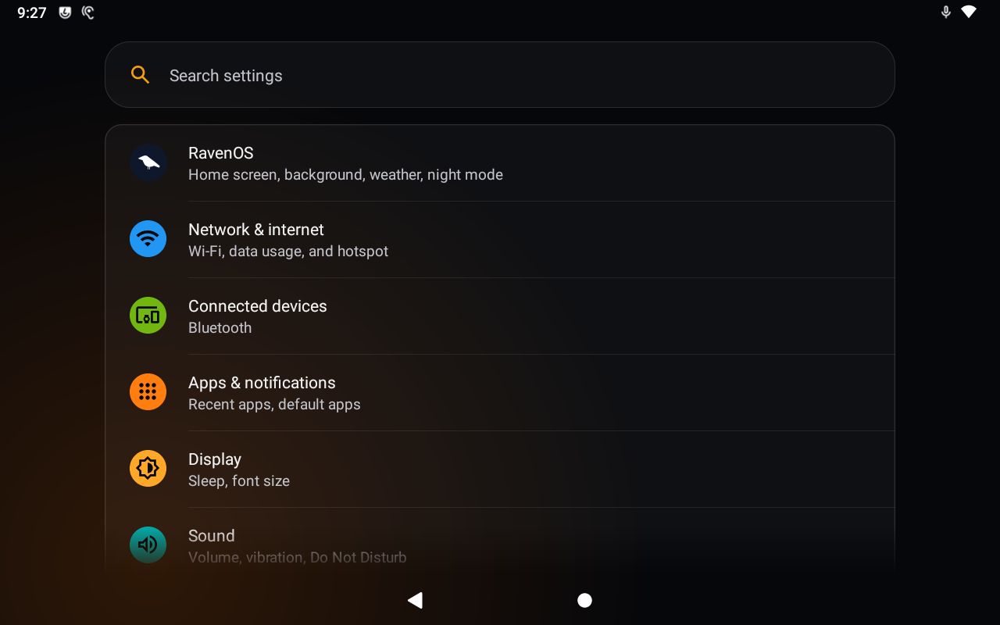
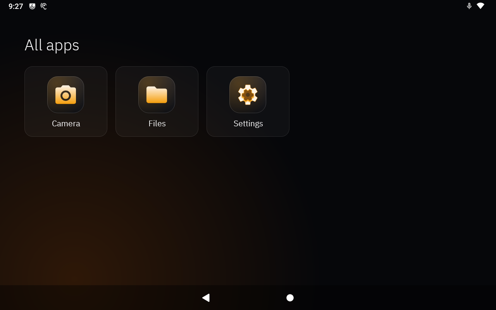
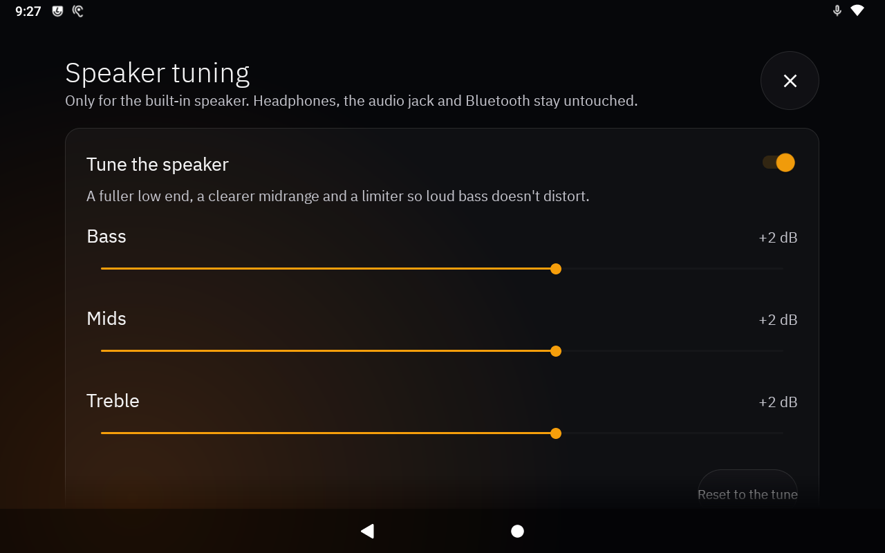
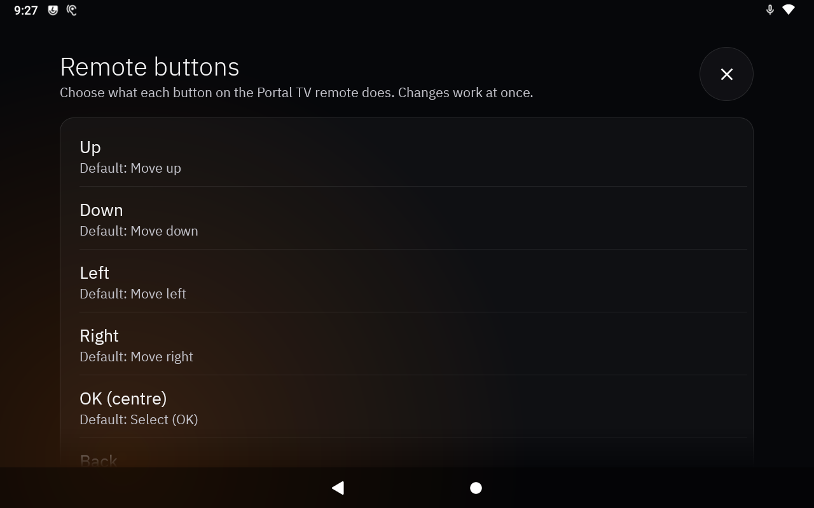
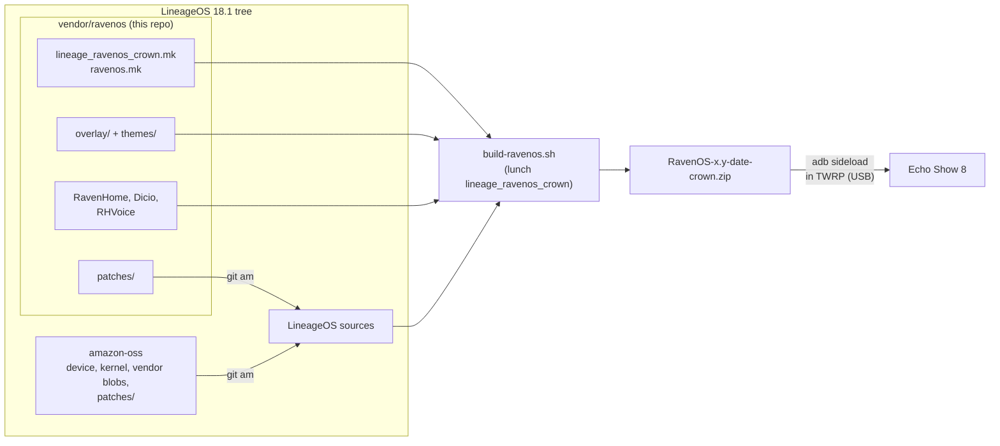

# RavenOS


-232F3E)


RavenOS turns a 1st gen Amazon Echo Show 8 (2019, codename `crown`) into an Alexa-free smart
display. It's built on LineageOS 18.1 and adds a clock-and-weather home screen, a Bluetooth
speaker mode with album art, offline "Hey Raven" voice control, Portal TV remote support and a
dark glass theme across the system.

> [!TIP]
> This repo is the `vendor/ravenos` folder of a LineageOS 18.1 tree. Clone it to
> **`vendor/ravenos`**, not on its own. It needs the amazon-oss device trees next to it.

<p align="center">
  
</p>
<p align="center">
  
  
  
  
</p>

> [!WARNING]
> Installing RavenOS means unlocking the Echo with the community **amonet** exploit, which can
> permanently brick it if interrupted. It erases Fire OS and everything on the device. Only the
> **1st gen (2019) Echo Show 8**, model C7H6N3, is supported. You do this at your own risk.

## Contents

- [Quick start](#quick-start)
- [Features](#features)
- [Using it](#using-it)
- [Setup in detail](#setup-in-detail)
- [Troubleshooting](#troubleshooting)
- [How it works](#how-it-works)
- [Project layout](#project-layout)
- [Development](#development)
- [Known limitations](#known-limitations)
- [License and privacy](#license-and-privacy)

## Quick start

These steps are for a Linux PC (Ubuntu or Debian) with about 300 GB free and 16 GB+ of RAM.

1. **Sync LineageOS 18.1 with the amazon-oss manifests**
   ```bash
   mkdir -p crown && cd crown
   repo init -u https://github.com/LineageOS/android.git -b lineage-18.1 --depth=1
   git clone https://github.com/amazon-oss/local_manifests.git -b lineage-18.1 .repo/local_manifests
   repo sync -c --no-clone-bundle --no-tags -j$(nproc --all)
   ```
2. **Add RavenOS and apply the patches.** Apply the amazon-oss patches first, then RavenOS's.
   ```bash
   git clone https://github.com/baverrr/RavenOS.git vendor/ravenos
   mkdir -p vendor/extra
   echo '-include vendor/ravenos/BoardConfigRavenOS.mk' > vendor/extra/BoardConfigExtra.mk
   bash patches/apply.sh
   bash vendor/ravenos/patches/apply.sh
   ```
   RavenOS's `apply.sh` skips patches that are already in place, so if one fails you can fix
   the conflict and run it again.
3. **Build**
   ```bash
   nice -n 18 ionice -c3 bash vendor/ravenos/build-ravenos.sh
   ```
   This makes `out/target/product/crown/RavenOS-<version>-<date>-crown.zip` and its `.sha256`.
   The script uses ccache when it's installed (`sudo apt install ccache`) and stops early if a
   RavenOS patch is missing from the tree, such as after a `repo sync`.
4. **Flash.** Follow [FLASHING.md](FLASHING.md): unlock with amonet, install TWRP, wipe, then
   sideload the zip.
5. **First boot.** Open **RHVoice** once and download an English voice so "Hey Raven" can talk.
   Copy a background video to `/sdcard/Movies/RavenOS/` if you want one (see
   [media/backgrounds](media/backgrounds/README.md)).

## Features

- **Home screen (RavenHome):** a clock over a looping video background of your choice. Tap it for
  the big clock, weather, alarms, timers, now playing and shortcuts. There's also a night mode
  and a device health page.
- **Bluetooth speaker:** the Echo shows up as "RavenOS". The now-playing card shows the phone's
  album art.
- **Speaker tuning:** an EQ and limiter for the built-in speaker, with Bass, Mids and Treble
  sliders in Settings › Sound. It turns itself off for headphones, the jack, USB and Bluetooth.
- **Rear jack for an amp:** no headphone volume limit, so a line-in amp gets full level.
- **"Hey Raven" voice control:** offline wake word, speech recognition and speech output, for
  reminders, alarms, a sleep screen, timers and weather. See [VOICE.md](VOICE.md).
- **Portal TV remote:** the D-pad moves focus everywhere, with visible focus rings and click
  sounds. Every button except Power can be reprogrammed on the Echo, in Settings › Connected
  devices › Remote buttons.
- **Glass theme:** Settings, Settings search, the keyboard, dialogs, toasts and notifications
  share one dark glass look, with a touch glow that follows your finger. Ten colour variants
  are in [`themes/`](themes); see [THEME.md](THEME.md).
- **Themed app icons:** every app in All apps, including ones installed later, is redrawn as an
  amber symbol on a dark glass tile.
- **Trimmed for a smart display:**
  - Removed: the Recents button, Battery, Accounts, Call volume, the encryption option,
    printing, and the Battery Saver and Data Saver tiles.
  - Tap sounds are quiet while media plays.
  - Wi-Fi is IPv4 only, so a local DNS filter can't be bypassed over IPv6.

## Using it

### Remote buttons (defaults)

| Button | Does |
| --- | --- |
| Up, Down, Left, Right, OK | Move focus, select |
| Back | Back |
| Home | Home screen |
| Play/pause | Play or pause what's playing |
| Volume up/down | Speaker volume |
| Mic | Mute |
| Red, Green, Blue | Nothing until you give them an action |
| Power | Sleep and wake (can't be changed) |

Change any of them, except Power, in **Settings › Connected devices › Remote buttons**. Changes
work straight away, and **Reset all buttons** restores the defaults.

### Voice

Say **"Hey Raven"**, then for example "remind me to call mom tomorrow at six pm", "wake me up
at seven" or "go to sleep". The full list is in [VOICE.md](VOICE.md#what-you-can-say).

### Useful adb commands

```bash
adb shell getprop ro.build.fingerprint         # which RavenOS build is running
adb push clip.mp4 /sdcard/Movies/RavenOS/      # add a home-screen background
adb connect <echo-ip>:5555                     # adb over Wi-Fi
```

## Setup in detail

<details>
<summary><b>Build options</b></summary>

- **One module:** `bash vendor/ravenos/build-ravenos.sh RavenHome` builds just that module.
- **Glass theme:** `RAVENOS_GLASS_THEME=tide bash vendor/ravenos/build-ravenos.sh` picks another
  variant. The default is `obsidian`, and the names are the folders in [`themes/`](themes).
- **Jobs:** `JOBS=12` sets the parallel build jobs (default 6).
- **Build numbers:** each build gets its own number, `rvYYMMDDHHMM`, in the fingerprint. This
  makes Android refresh its app cache after a dirty flash.
- **Local identity:** the build user and host are set to `ravenos`, so your username and
  hostname stay out of `build.prop`.

</details>

<details>
<summary><b>Connecting an amp to the rear jack</b></summary>

Use a 3.5 mm stereo to 2×RCA cable into the amp's AUX, line or CD input (never phono).

1. Set the Echo to about 80–90 % volume.
2. Set the amp to the loudest you'd ever want.
3. From then on, control volume from the Echo or the remote.

While the jack is in use, the built-in speaker goes quiet and the speaker tuning switches off.
If you hear hum, power both from the same strip or add a ground loop isolator.

</details>

<details>
<summary><b>Retraining the "Hey Raven" wake word</b></summary>

[`tools/wakeword`](tools/wakeword) holds a Docker-based openWakeWord training pipeline. It uses
synthetic Piper voices and public datasets, and needs no recordings of your own. Its output goes
to `wakeword/hey_raven.tflite`, which the Dicio patches bundle. See
[VOICE.md](VOICE.md#the-hey-raven-model).

</details>

## Troubleshooting

| Problem | Fix |
| --- | --- |
| Apps show wrong labels or colours after flashing | Make sure the build has a new `rv…` build number; dirty flashes need one. |
| "Hey Raven" answers on screen but doesn't speak | Open RHVoice and download an English voice. |
| The home screen has no background | Put an `.mp4` in `/sdcard/Movies/RavenOS/` and grant RavenHome storage access. |
| A remote button change does nothing | Check that **Remote buttons** is enabled in Settings › Accessibility. RavenHome turns it on by itself when you change a button. |
| The flash stops with "system app updates in /data" | Uninstall the updates of the listed system apps (`adb uninstall <pkg>` keeps the system copy), then flash again. |
| The Echo won't boot after a flash | Hold the buttons for TWRP and see [FLASHING.md › Recovery](FLASHING.md#recovery). |

## How it works



- **Product:** `lineage_ravenos_crown` inherits the amazon-oss `crown` device and LineageOS's
  core config only, skipping the bundled phone apps. It then adds `ravenos.mk`.
- **Overlays:** `overlay/` changes framework, SystemUI and Settings resources. The chosen theme
  in `themes/<name>/overlay` is compiled into the apps instead of shipped as runtime overlays.
- **Patches:** source changes too big for an overlay are kept as `git am` patches in `patches/`,
  in folders that mirror the project they patch. They cover the glass theme, audio,
  Bluetooth, Settings, the camera and Wi-Fi.
- **RavenHome:** the launcher and the RavenOS settings pages. It also runs device-wide pieces:
  the speaker tuning effect and the remote-button accessibility service.

## Project layout

<details>
<summary><b>Folders and files</b></summary>

| Path | What it is |
| --- | --- |
| `AndroidProducts.mk`, `lineage_ravenos_crown.mk`, `ravenos.mk` | The RavenOS product and what goes into the image |
| `BoardConfigRavenOS.mk` | Board overrides, loaded from `vendor/extra/BoardConfigExtra.mk` |
| `build-ravenos.sh` | Builds the flashable zip (or one module) |
| `apps/RavenHome/` | Launcher, home screen, alarms, speaker tuning, remote buttons, themed icons |
| `apps/Dicio/`, `apps/RHVoice/` | Voice assistant (patched fork, prebuilt) and offline text-to-speech |
| `patches/` | `git am` patches for LineageOS projects, with `apply.sh` |
| `overlay/` | Resource overlays for the framework, SystemUI, Settings and others |
| `themes/` | Glass theme variants and `generate.py` |
| `rro/RavenWifiOverlay/` | Runtime overlay for Wi-Fi (IPv4 only) |
| `removals/` | Stock packages left out of the image |
| `keylayout/` | Key layout for the Portal TV remote |
| `bluetooth/` | Bluetooth name ("RavenOS") |
| `bootanimation/` | Boot animation |
| `etc/` | Permissions and default grants |
| `media/backgrounds/` | How to make home-screen videos (the videos aren't in the repo) |
| `wakeword/`, `tools/wakeword/` | The "Hey Raven" model and its training pipeline |
| `docs/` | Images and design notes |
| `FLASHING.md`, `VOICE.md`, `THEME.md` | Install guide, voice control, theme |
| `CHANGELOG.md` | Every build flashed to the test Echo and what went into it |

</details>

## Development

- **Making a patch:** commit the change in the LineageOS project, then export it into the
  matching folder here, numbered after the last one:
  ```bash
  git -C packages/apps/Settings format-patch -1 -o "$PWD/vendor/ravenos/patches/packages/apps/Settings" --start-number 19
  ```
- **Logging:** every flashed build gets an entry in [CHANGELOG.md](CHANGELOG.md), listing what
  changed and how it was checked.
- **Commit identity:** use the GitHub noreply identity. Keep real names, emails, IP and MAC
  addresses, serial numbers and keys out of commits, docs and screenshots.

## Known limitations

- **Echo Show 8 1st gen (2019) only.** The 2nd gen and other Echo models aren't covered here.
- **Flashing needs USB.** TWRP has no Wi-Fi.
- **No encryption.** `/data` has no encryption flags, so the option is hidden.
- **The Power button can't be remapped.** Android handles it before accessibility services
  see it.
- **The build isn't signed for release.** It's a `userdebug` build with test keys, and adb is
  on, including over Wi-Fi on port 5555. Keep the Echo on a network you trust.
- **No background video is included.** The example wallpaper is third-party, so bring your own.

## License and privacy

- **License:** RavenOS's own code, overlays and patches are under the
  [Apache License 2.0](LICENSE), like the AOSP and LineageOS code they change. The bundled apps
  keep their own licenses:
  - Dicio: GPL-3.0. The fork is upstream [Dicio](https://github.com/Stypox/dicio-android) plus
    `apps/Dicio/patches`, rebuilt with `apps/Dicio/build-dicio.sh`.
  - RHVoice: LGPL-2.1 and GPL. It's the [F-Droid build](https://f-droid.org/packages/com.github.olga_yakovleva.rhvoice.android/)
    of [RHVoice](https://github.com/RHVoice/RHVoice).
  - The openWakeWord tooling: Apache 2.0.
  - The IBM Plex Sans fonts: SIL Open Font License 1.1
    ([apps/RavenHome/FONTS-LICENSE.txt](apps/RavenHome/FONTS-LICENSE.txt)).
- **Privacy:** RavenOS has no accounts, analytics or cloud services. Voice is processed entirely
  on the Echo. Weather, from Open-Meteo, is the only regular internet
  request.
